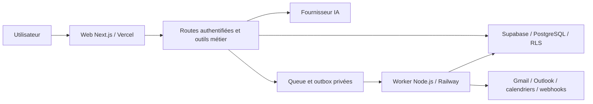

# Architecture de Relay

Carte du dépôt après le rangement du 9 octobre 2026. Pour commencer à contribuer : [guide de contribution](../../CONTRIBUTING.md). Les mesures et limites sont dans [l'analyse du dépôt](repository-audit.md) et [les performances](../performance/README.md).

## Vue d'ensemble

Relay contient deux exécutables partageant les bibliothèques TypeScript : le serveur web Next.js et le worker Node.js. Supabase gère Auth, PostgreSQL, RLS et Storage. La file de jobs et l'outbox sont en PostgreSQL ; il n'existe pas de second moteur d'agent ou de queue à maintenir.



Le modèle IA reçoit des contrats d'outils et des résultats filtrés ; il ne reçoit pas de connexion SQL, clé privilégiée ou token OAuth. Un accès privilégié du worker n'est pas une permission métier : ses handlers et RPC doivent toujours vérifier le contexte de l'action.

## Arborescence et responsabilités

```text
src/
  app/                   conventions Next.js, pages et endpoints
  components/
    pages/               composition des écrans CRM
    assistant/           chat, sources, actions, composer, Pulse
    dashboard/           dashboard et éditeur de widgets
    records/             fiches, tableaux, vues, import/export
    settings/            apparence, usage, équipe et accès
    communications/      lecture de fils et composition de modèles
    integrations/        interface Zapier
    reports/             prévisions et constructeur de rapports
    portal/              interface du portail client
    help/                aide destinée aux utilisateurs
    jobs/                état des traitements différés
    layout/              shell, sidebar et notifications
    providers/           contexte React, cache et apparence
    ui/                  primitives et champs partagés
    workflows/           constructeur et suivi des automatisations
    ui.tsx               point d'entrée existant des dialogues/formulaires
  lib/
    domain/              types, schemas et calculs métier
    api/                 session, validation, filtres, lectures et RPC
    agent/               orchestration, outils, sécurité et fournisseur IA
    integrations/        OAuth, sync, livraison et adaptateurs externes
    jobs/                queue, lanes, runner et handlers
    supabase/            clients navigateur/serveur/privilégié et session
    observability/       logs, protection des contenus et monitoring
    team/                invitations serveur
    help/                données des guides affichés dans /doc
  proxy.ts               traitement de session à l'entrée
  instrumentation-client.ts
scripts/
  worker.mts             exécutable Railway
  start.ps1              lancement de développement Windows
  tests/                 lanceurs SQL, concurrence, évaluation et charge
  maintenance/           vérifications du dépôt
supabase/
  migrations/            historique SQL canonique, immuable après application
  tests/                 assertions SQL
  legacy/                scripts initiaux archivés
docs/                    architecture, fonctionnalités, exploitation et historique
deploy/                  exemples de variables web et worker
public/                  ressources publiques et polices locales
```

Les composants `.test.ts(x)` restent auprès du code. Les CSS Modules sont regroupés avec la fonctionnalité qui les utilise. Les configurations Next.js, Vercel, Railway, Docker, TypeScript, ESLint et Vitest restent à la racine conformément aux outils.

## Parcours à connaître

### Session et accès au CRM

`src/proxy.ts` et `src/lib/supabase/session.ts` gèrent la session à l'entrée ; `src/app/app/layout.tsx` et les routes publiques contrôlent l'orientation de l'utilisateur. `src/lib/supabase/server.ts` fournit le client lié aux cookies ; `client.ts` le client navigateur ; `admin.ts` est strictement serveur. Le [guide de session](session-management.md) décrit refresh et conservation des cookies.

`src/lib/api/context.ts` vérifie l'utilisateur et son membership actuel, puis la capacité d'écriture. Les lectures avec ce client restent soumises à RLS. Ne pas remplacer cette chaîne par une clé privilégiée pour une opération utilisateur.

### Lecture et écriture d'une fiche

`src/app/app/[section]/page.tsx` sélectionne l'écran ; `src/components/pages/records.tsx` et `record-details.tsx` composent les composants de `records/`. Les providers gèrent les appels et le cache React Query. Les routes `src/app/api/[workspace]/[resource]/route.ts` et `context/route.ts` utilisent `src/lib/api/` et les fonctions PostgreSQL.

Les règles de filtres et d'attributs sont dans `src/lib/domain/`, avec les schémas partagés dans `resource-schemas.ts`. Ce catalogue Zod est utilisable par les imports, l'agent et les routes sans dépendre d'un adaptateur serveur. Pagination, lecture des sources privées, contrôle de version et workspace restent applicables même si une section est chargée à la demande. Les clés étrangères composites et RLS défendent les relations entre workspaces ; une relation visible ne rend pas automatiquement visibles ses notes ou emails privés.

`src/lib/api/request.ts` borne les appels CRM et masque les erreurs réseau/serveur. `useSave` valide les données et exige une ligne confirmée avant le succès. Les créations utilisent une clé UUID stable pendant une reprise ; la route réutilise uniquement une ligne du même workspace avec les mêmes valeurs. Les modifications conservent le contrôle de version. L’éditeur garde un brouillon de session, limité à 24 heures et séparé par environnement, projet, utilisateur et workspace ; les données stockées restent non fiables, revérifiées avant écriture et effacées après confirmation ou changement de compte. Un stockage navigateur bloqué conserve seulement la saisie en mémoire ; ce brouillon ne remplace pas une sauvegarde serveur.

### Dashboard, rapports, Priorités et doublons

`src/components/dashboard/` et `reports/` utilisent les routes `reports/`, avec `src/lib/api/dashboards.ts` pour le batch. Les agrégats, score Priorités et candidats doublons sont calculés en SQL. Le cache PostgreSQL tient compte des droits et des révisions ; seul le périmètre de fiches entièrement autorisé peut être mutualisé. Les sources privées restent par utilisateur.

Les vues de doublons conservent la seconde vérification TypeScript, aperçu, versions et restauration ; l'organisation des fichiers ne change pas leur contrat. Voir [doublons](../features/crm/duplicate-lifecycle.md) et [performances](../performance/README.md).

### Ask Relay, du message à l'action

L'écran `src/components/pages/assistant.tsx` utilise les composants de `assistant/`. `src/app/api/[workspace]/assistant/route.ts` adapte la requête et le streaming ; `src/lib/agent/runner.ts` orchestre les appels. `contracts.ts` définit les schémas et descriptions, `discovery.ts` sélectionne les outils, `tools.ts` réalise les recherches et prépare les actions, `security.ts` impose les frontières de confiance et `provider.ts` adapte OpenAI/Groq.

Les 37 outils métier restent disponibles avec découverte progressive. Le message utilisateur est séparé des résultats non fiables. Les citations sont vérifiées sur les sources autorisées et consultées. Les mutations passent par les autorisations et confirmations exactes du backend ; une instruction d'email ne devient jamais une autorisation. Les quotas et événements fournisseur sont réservés et enregistrés en base.

L'exécution différée passe par la route `assistant/actions/`, les fonctions SQL et `src/lib/jobs/handlers/agent.ts`. L'interface montre le statut de l'action renvoyé par le serveur. Elle ne déduit pas « envoyé » du texte du modèle. Voir [l'agent et sa sécurité](../features/ask-relay/ask-relay-agent.md).

### Intégrations et worker

La [nouvelle plateforme d’intégrations](../integrations/README.md) est une fondation séparée, désactivée par défaut. Son vault privé, OAuth partagé Google, commandes confirmées et jobs utilisent les mécanismes existants ; les connecteurs et connexions historiques ne sont pas remplacés implicitement. Le document précise les contrôles réalisés et ce qui reste nécessaire avant activation générale.

Les routes OAuth et connexions s'appuient sur `src/lib/integrations/oauth.ts`, `services.ts` et `crypto.ts`. Les jetons OAuth chiffrés restent côté serveur et dans le stockage privé. Synchronisation et livraison sont séparées : `sync.ts`, `meetings.ts`, `delivery.ts`, `sequence-worker.ts`, `worker-client.ts`.

`scripts/worker.mts` démarre santé, métriques, heartbeat, scheduling et slots bornés. `src/lib/jobs/client.ts` adapte les RPC de queue ; `lanes.ts` sépare capacité interactive et import/sync ; `runner.ts` gère résultat/retry ; `handlers/` distribue les jobs. Les leases, `SKIP LOCKED`, outbox et états incertains restent le contrat de fiabilité. Les variables Railway sont indépendantes de Vercel.

### Landing, aide et portail

`src/app/page.tsx` et `landing-preview.tsx` utilisent des données fictives et des composants de présentation, sans embarquer les accès CRM. Le test `landing-isolation.test.ts` traverse leurs dépendances. `src/components/layout/app-sidebar-view.tsx` est la vue pure ; `app-sidebar.tsx` son adaptateur authentifié.

`src/lib/help/guides.ts` contient les textes de `/doc`, distincts de cette documentation développeur. Les portails utilisent les routes `portal/` et `src/components/portal/client.tsx` ; leurs ressources explicitement partagées ne doivent pas hériter de tout le workspace.

## Évolution et limites

Les notes privées restent réservées à leur auteur et les communications à l'utilisateur du compte connecté. Les notes ont un versionnement optimiste, pas une édition collaborative CRDT. Les URL Storage signées ont une durée de validité ; retirer un droit n'efface pas une URL déjà émise avant son expiration.

Les exports synchrones et les grands écrans restent des points à surveiller. Les mesures SQL isolées existent désormais, mais ne prouvent pas la capacité globale web/auth/fournisseurs. Les exigences de sauvegarde/restauration, rétention, monitoring et validation des fournisseurs relèvent aussi de l'exploitation. Voir [l'analyse actuelle](repository-audit.md) et [le guide de déploiement](../operations/deployment.md).

La précédente note d'architecture est conservée comme [archive datée](../history/architecture-before-2026-10-09.md). Toute évolution de permissions, contrat d'outil, schéma ou queue doit mettre à jour cette carte et les tests pertinents.
